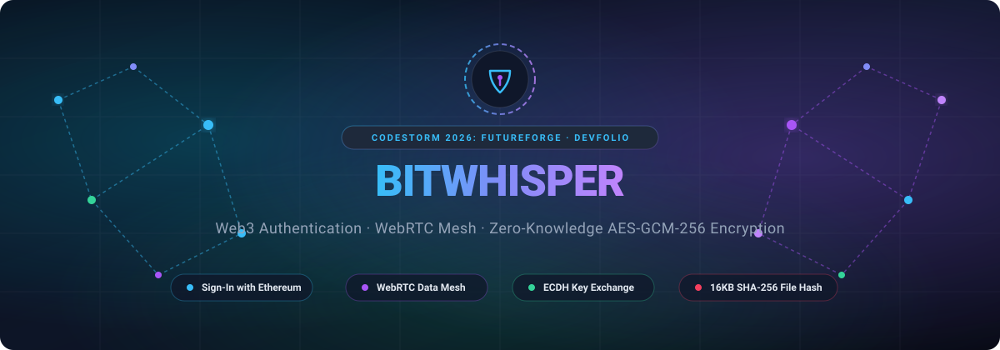
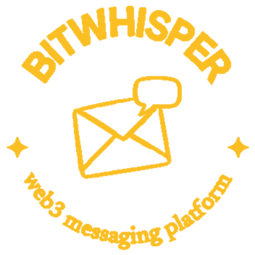

<a id="top"></a>

<p align="center">
  
</p>

<p align="center">
  
</p>

<h1 align="center">BitWhisper — Your conversations, truly private.</h1>

<p align="center">
  Direct browser-to-browser encrypted messaging, peer discovery, and verified file transfers.<br>
  <strong>A decentralized, zero-knowledge chat workspace built with React 18, WebRTC, Web Crypto API, and Node.js.</strong>
</p>

<p align="center">
  <a href="https://devfolio.co/projects/bitwhisper-77cc"></a>
  <a href="#development"></a>
  <a href="#development"></a>
  <a href="#development"></a>
  <a href="#cryptographic-architecture"></a>
  <a href="#using-the-workspace"></a>
  <a href="#cryptographic-architecture"></a>
  <a href="#quick-start"></a>
  <a href="LICENSE"></a>
</p>

<p align="center">
  <a href="#quick-start"><strong>🚀 Quick start</strong></a> ·
  <a href="#using-the-workspace"><strong>🧭 Workspace guide</strong></a> ·
  <a href="#cryptographic-architecture"><strong>🔐 Cryptography &amp; flow</strong></a> ·
  <a href="#development"><strong>🛠️ Development</strong></a> ·
  <a href="#built-by"><strong>👨‍💻 Built By</strong></a>
</p>

<p align="center">
  <strong>🏆 Built for CodeStorm 2026: FutureForge on Devfolio by Jose Regish J (<a href="https://github.com/hackerjose25">@hackerjose25</a>)</strong>
</p>

---

## Meet BitWhisper

BitWhisper turns your web browser into an autonomous, encrypted communication node. By merging decentralized Web3 identity (**Sign-In with Ethereum**) with direct peer-to-peer **WebRTC DataChannels** and native browser **Web Crypto API** primitives (ECDH + AES-GCM-256), BitWhisper ensures that your messages and file transfers never touch a central server, are never logged, and cannot be intercepted.

<table>
  <tr>
    <td width="33%" valign="top">
      <h3>🟢 Direct P2P mesh</h3>
      <p>Direct WebRTC <code>RTCDataChannel</code> links between room peers. The server only brokers initial handshakes and never touches message payloads.</p>
    </td>
    <td width="33%" valign="top">
      <h3>🔒 End-to-end encryption</h3>
      <p>Ephemeral ECDH (NIST P-256) key agreement creates shared AES-GCM-256 keys in browser memory for perfect forward secrecy.</p>
    </td>
    <td width="33%" valign="top">
      <h3>🛡️ Web3 identity</h3>
      <p>Cryptographic wallet login via Sign-In with Ethereum (SIWE / ERC-4361). Passwordless, privacy-preserving, and completely gas-free.</p>
    </td>
  </tr>
  <tr>
    <td valign="top">
      <h3>📁 Verified file sharing</h3>
      <p>Transfer files peer-to-peer with 16KB encrypted chunk streaming, transfer progress tracking, and client-side SHA-256 hash validation.</p>
    </td>
    <td valign="top">
      <h3>💬 Dynamic chat workspace</h3>
      <p>Feature-rich room experience with emoji reactions, message pinning, live connection status indicators, and custom audio alerts.</p>
    </td>
    <td valign="top">
      <h3>🎨 Immersive 3D canvas</h3>
      <p>Glassmorphic dark design system with an interactive Three.js and Vanta.js animated network topology background canvas.</p>
    </td>
  </tr>
</table>

> [!NOTE]
> WebRTC and the browser's native `SubtleCrypto` API **strictly require a secure context** (HTTPS / WSS), even when testing locally. Use local certificates generated with `mkcert`. See [security and cryptographic boundaries](#security-and-cryptographic-boundaries) for key lifecycle and protocol guarantees.

---

## Quick start

### 1 · Check prerequisites

| Requirement | What you need |
| :--- | :--- |
| 🟩 Node.js | **18.0+** (LTS recommended), with npm |
| 📜 mkcert | [mkcert](https://github.com/FiloSottile/mkcert) for trusted local SSL certificates |
| 🦊 Web3 Wallet | [MetaMask](https://metamask.io/) or any EVM-compatible browser wallet extension |
| 🌐 Modern Browser | Chrome, Firefox, Brave, Safari, or Edge supporting WebRTC & Web Crypto API |

---

### 2 · Generate local SSL certificates

Because modern browsers disable `crypto.subtle` and WebRTC on insecure HTTP origins, you must generate a local certificate once with `mkcert`:

```powershell
# Install the mkcert local Certificate Authority (CA)
mkcert -install

# Generate certificates for localhost and loopback interfaces
mkcert localhost 127.0.0.1 ::1
```

This creates two files in your current directory:
- `localhost.pem` (Certificate)
- `localhost-key.pem` (Private Key)

Copy both files into **both** the `server/` and `client/` directories:

```powershell
Copy-Item localhost.pem, localhost-key.pem -Destination server/
Copy-Item localhost.pem, localhost-key.pem -Destination client/
```

---

### 3 · Install dependencies and launch

Run the signaling server and client application in separate terminals from the repository root:

#### Terminal 1 — Start the Signaling Server:
```powershell
cd server
npm install
npm run dev
```
*The signaling server starts over secure HTTPS/WSS on port `3001`.*

#### Terminal 2 — Start the React Client:
```powershell
cd client
npm install
npm run dev
```
*The Vite development server boots over HTTPS on `https://localhost:5173`.*

---

### 4 · Open your workspace

Open **[https://localhost:5173](https://localhost:5173)** in your browser.

> [!TIP]
> **Browser Warning**: If your browser displays *"Your connection is not private"* (due to a self-signed local cert), click **Advanced** → **Proceed to localhost (unsafe)**.  
> **Testing Multi-Peer Chat**: Open a second browser window (or Incognito mode) at `https://localhost:5173`. Connect with a second account or test profile to immediately see the WebRTC peer mesh establish and the **"🔒 AES-GCM-256 E2E"** badge activate.

<p align="right"><a href="#top">Back to top ↑</a></p>

---

## What changed from centralized chat

<details>
<summary><strong>⚡ Explore the decentralized architecture advantages</strong></summary>

- **Zero Server Knowledge**: The Node.js server acts strictly as an ephemeral signaling broker (passing SDP offers, answers, and ICE candidates). It cannot decrypt, read, or alter chat messages.
- **Direct WebRTC Data Channels**: After the handshake, data flows directly between browser clients over an encrypted P2P mesh network (`RTCDataChannel`).
- **Ephemeral ECDH Keys**: Keypairs are generated in volatile browser memory per session using NIST P-256 elliptic curves. Closing the tab wipes the keys forever.
- **Passwordless Identity**: Sign-In with Ethereum (EIP-4361) replaces usernames and passwords with cryptographic signatures. No user database is ever maintained.
- **Chunked File Streaming with SHA-256**: Files are split into 16KB blocks, encrypted individually, and validated against a pre-computed SHA-256 checksum upon reassembly.
- **Resilient Mesh State**: When peers join or leave, the mesh automatically renegotiates data channels without interrupting the rest of the room.

</details>

---

## Using the workspace

**Connect → Sign → Join → Exchange → Chat & Transfer**

1. **Connect Wallet**: Click **Get Started** or **Connect Wallet** on the landing page and select your Ethereum provider (MetaMask).
2. **Sign In (SIWE)**: Sign the gasless cryptographic challenge generated via the **Sign-In with Ethereum** standard to authenticate your identity.
3. **Choose Display Name & Room**: Enter an alias and select your active room (`#general`, `#gaming`, `#music`, `#coding`, `#random`).
4. **Automatic Peer Mesh**: When other users join the same room, WebRTC signaling negotiates peer-to-peer data channels automatically.
5. **Key Agreement**: Both clients execute an **ECDH** key exchange over the newly opened data channel and derive an identical **AES-GCM-256** shared secret.
6. **Encrypted Chatting**: Send messages, add emoji reactions, and pin messages. Every payload is encrypted with AES-GCM before transmission.
7. **Secure File Transfers**: Drag and drop or attach files. BitWhisper fragments them into 16KB chunks, sends them across the direct data channel, and verifies their SHA-256 checksum on arrival.

---

## Cryptographic architecture

> [!IMPORTANT]
> Cryptographic keys are **ephemeral** and generated natively using the browser's **Web Crypto API** (`window.crypto.subtle`). Private keys are non-extractable and never transmitted over the wire or stored in `localStorage`.

### Protocol flow diagram

```text
  [ Peer A Browser ]                                                   [ Peer B Browser ]
          │                                                                    │
          │ 1. Join Room (WSS)                             1. Join Room (WSS)  │
          ├─────────────────────► [ Signaling Server ] ◄──────────────────────┤
          │                         (Port 3001 - WSS)                          │
          │                                                                    │
          │ 2. Server notifies A of B                      3. Server notifies  │
          │◄──────────────────── [ Signaling Server ] ───►    B of A           │
          │                                                                    │
          │ 4. WebRTC Offer (via Signaling Server)                             │
          ├─────────────────────► [ Signaling Server ] ───────────────────────►│
          │                                                                    │
          │ 5. WebRTC Answer (via Signaling Server)                            │
          │◄──────────────────── [ Signaling Server ] ◄────────────────────────┤
          │                                                                    │
          │════════════════════════════════════════════════════════════════════│
          │        6. Direct WebRTC Data Channel Established (Mesh)            │
          │════════════════════════════════════════════════════════════════════│
          │                                                                    │
          │ 7. Send Ephemeral ECDH Public Key (PubKey_A)                       │
          ├───────────────────────────────────────────────────────────────────►│
          │ 8. Send Ephemeral ECDH Public Key (PubKey_B)                       │
          │◄───────────────────────────────────────────────────────────────────┤
          │                                                                    │
          │ 9. Compute Shared Secret:                     9. Compute Shared    │
          │    ECDH(Priv_A, Pub_B)                           Secret:           │
          │    Derive AES-GCM-256 Key                        ECDH(Priv_B, Pub_A│
          │                                                                    │
          │════════════════════════════════════════════════════════════════════│
          │        10. Encrypted P2P Messages & 16KB Chunks (AES-GCM-256)      │
          │◄══════════════════════════════════════════════════════════════════►│
```

<details>
<summary><strong>🧪 Explore cryptographic algorithm and key exchange specifications</strong></summary>

### 1. Key Agreement (ECDH NIST P-256)
- **Algorithm**: Elliptic Curve Diffie-Hellman (`ECDH`).
- **Named Curve**: NIST P-256 (`secp256r1`).
- **Key Usages**: `deriveKey`, `deriveBits`.
- **Extraction**: Private keys are generated with `extractable: false`, preventing arbitrary script extraction or browser memory leaks.

### 2. Symmetric Cipher (AES-GCM-256)
- **Algorithm**: Advanced Encryption Standard in Galois/Counter Mode (`AES-GCM`).
- **Key Length**: 256 bits.
- **Initialization Vector (IV)**: A cryptographically secure random 12-byte IV is generated via `crypto.getRandomValues(new Uint8Array(12))` for every single message.
- **Authentication Tag**: 128-bit integrity tag prevents tampering and replay modifications.

### 3. File Chunking & Integrity (SHA-256)
- Files are segmented into **16 KB (16,384 bytes)** binary chunks.
- Prior to transmission, the sender calculates a **SHA-256 digest** of the entire raw file buffer.
- Individual chunks are encrypted and streamed over the `RTCDataChannel`.
- Upon receiving all chunks, the recipient reassembles the binary array, computes the SHA-256 checksum locally, and verifies matching hashes before presenting the file to the user.

</details>

<p align="right"><a href="#top">Back to top ↑</a></p>

---

## Security and cryptographic boundaries

| Scope | Specification / Boundary |
| :--- | :--- |
| 🔐 Symmetric Cipher | **AES-GCM-256** with unique 12-byte initialization vectors |
| 🤝 Key Agreement | **ECDH NIST P-256** ephemeral in-memory key agreement |
| 🔑 Perfect Forward Secrecy | Fresh keys generated per session; deleted on tab exit |
| 🛡️ Identity Protocol | **Sign-In with Ethereum** (SIWE / EIP-4361) |
| 📦 File Chunking | **16 KB chunks** with SHA-256 integrity hash verification |
| 🌐 Mesh Limits | Up to **4 concurrent peers per room** (full-mesh topology) |
| 💾 Server Persistence | **0 bytes** stored (zero database, zero logs, zero relays) |
| 🔒 Transport Requirement | Strict **HTTPS & WSS** secure contexts enforced |

<details>
<summary><strong>📏 Read security threat model, NAT traversal, and browser isolation details</strong></summary>

- **Zero-Knowledge Signaling**: The signaling server only receives standard SDP offers/answers and ICE candidate exchange strings. It never receives cryptographic keys, message plaintext, or file data.
- **Ephemeral Key Lifecycle**: Cryptographic keys are bound exclusively to the current browser session. Tab reloads discard prior keys and initiate a fresh handshake with peers.
- **Man-in-the-Middle (MITM) Mitigations**: The initial public key exchange occurs over direct WebRTC data channels authenticated through peer identity.
- **Local Network & NAT**: WebRTC utilizes Google STUN servers (`stun.l.google.com:19302`) for NAT traversal. For symmetric NATs or restrictive enterprise networks, a TURN relay can be configured in `webrtc.js`.
- **Data Protection at Rest**: No chat history, personal details, or transferred files are written to local storage, cookies, or remote databases. All message memory is wiped upon room departure.

</details>

---

## Development

Run both the frontend and backend in development mode with hot reload:

```powershell
# Terminal 1: Signaling server with nodemon
cd server
npm run dev

# Terminal 2: React client with Vite hot module replacement (HMR)
cd client
npm run dev
```

### Production build

```powershell
# Build client for production
cd client
npm run build

# Preview production build locally
npm run preview
```

### Environment configuration

| Variable | Location | Description | Default |
| :--- | :--- | :--- | :--- |
| `PORT` | `server/.env` | Port for the signaling server | `3001` |
| `NODE_ENV` | `server/.env` | Runtime environment (`development` / `production`) | `development` |
| `VITE_WEBSOCKET_URL` | `client/.env` | Custom WebSocket signaling endpoint | `wss://localhost:3001` |

<p align="right"><a href="#top">Back to top ↑</a></p>

---

## Project structure

<details>
<summary><strong>🗂️ Explore the repository layout</strong></summary>

```text
├── client/
│   ├── src/
│   │   ├── app.jsx                  Main workspace coordinator & room state management
│   │   ├── main.jsx                 Application bootstrap & React DOM render root
│   │   ├── index.css                Tailwind CSS directives & custom glassmorphism styles
│   │   ├── components/
│   │   │   ├── ChannelSidebar.jsx   Room navigation, active peer list, and presence
│   │   │   ├── ChatWindow.jsx       Chat area, text input, emoji picker & pinning
│   │   │   ├── FileTransferProgress.jsx Progress tracker & SHA-256 validation modal
│   │   │   ├── FileUpload.jsx       Drag-and-drop file attachment handler
│   │   │   ├── LandingPage.jsx      3D animated landing page & feature showcase
│   │   │   ├── MessageList.jsx      Encrypted message rendering & reaction pills
│   │   │   ├── ServerList.jsx       Quick workspace/server switching strip
│   │   │   ├── ThreeBackground.jsx  React Three Fiber 3D interactive particle canvas
│   │   │   └── WalletLoginModal.jsx SIWE wallet connection & signature verification
│   │   └── utils/
│   │       ├── crypto.js            Web Crypto API (ECDH P-256 + AES-GCM-256)
│   │       ├── fileTransfer.js      16KB chunking, buffer reassembly & SHA-256 hashing
│   │       ├── notificationSounds.js Synthesized audio cues for messages and joins
│   │       ├── walletAuth.js        Ethers.js provider & SIWE challenge verification
│   │       └── webrtc.js            WebRTC mesh orchestrator & RTCDataChannel manager
│   ├── package.json                 Frontend dependencies & Vite scripts
│   ├── tailwind.config.js           Tailwind styling system tokens
│   └── vite.config.js               Vite build configuration & HTTPS SSL setup
├── server/
│   ├── server.js                    Node.js & ws signaling server with HTTPS/WSS
│   └── package.json                 Server dependencies (express, ws, nodemon)
├── docs/
│   ├── assets/
│   │   └── readme-hero.svg          Vector banner artwork for README
│   └── screenshots/
│       ├── landing-preview.svg      Landing page & Web3 authentication preview
│       ├── chat-workspace.svg       Chat room, channel sidebar & peers preview
│       ├── file-transfer.svg        P2P 16KB file transfer & SHA-256 validation diagram
│       ├── security-keys.svg        Cryptographic pipeline & key agreement diagram
│       └── mobile-preview.svg       Responsive mobile layout preview
├── LICENSE                          MIT License
└── README.md                        Project documentation & architecture manual
```

</details>

---

<a id="built-by"></a>

## 👨‍💻 Built By

The BitWhisper platform was conceptualized, designed, and solo-engineered by:

| Builder | Role | Contribution | Profile |
| :--- | :--- | :--- | :--- |
| **Jose Regish J** | **Solo Creator & Full Stack Engineer** | Built for **CodeStorm 2026: FutureForge** (Devfolio). Architected the full-stack system: React 18 decentralized workspace, Web3 SIWE cryptographic authentication, WebRTC mesh signaling and data channels, ECDH P-256 + AES-GCM-256 client encryption pipeline, 16KB chunked file streaming with SHA-256 checksum validation, and Three.js visual environment. | [](https://github.com/hackerjose25) [](https://www.linkedin.com/in/hackerjose25/) |

---

### 🏆 Hackathon Details

- **Hackathon**: CodeStorm 2026: FutureForge
- **Platform**: [Devfolio Project Showcase](https://devfolio.co/projects/bitwhisper-77cc)
- **Built By**: Jose Regish J ([@hackerjose25](https://github.com/hackerjose25))
- **Track**: Decentralized Communication, Web3 Security & Privacy

---

## 📄 License

This project is open-source and available under the **[MIT License](LICENSE)**.

```text
Copyright (c) 2026 Jose Regish J (hackerjose25)
```

<p align="center">
  <strong>Zero servers. Zero logs. Pure privacy.</strong><br>
  <a href="#top">Back to top ↑</a> · <a href="#quick-start">Launch BitWhisper →</a>
</p>
